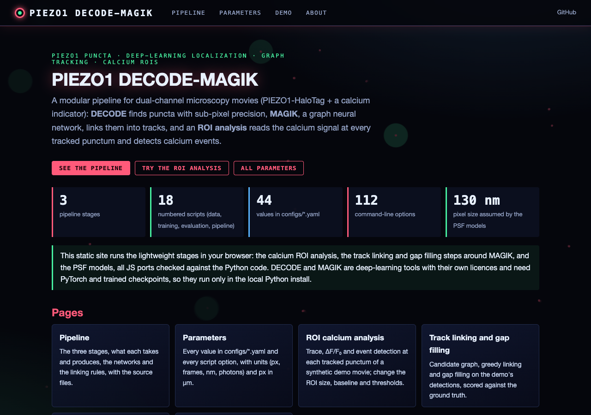
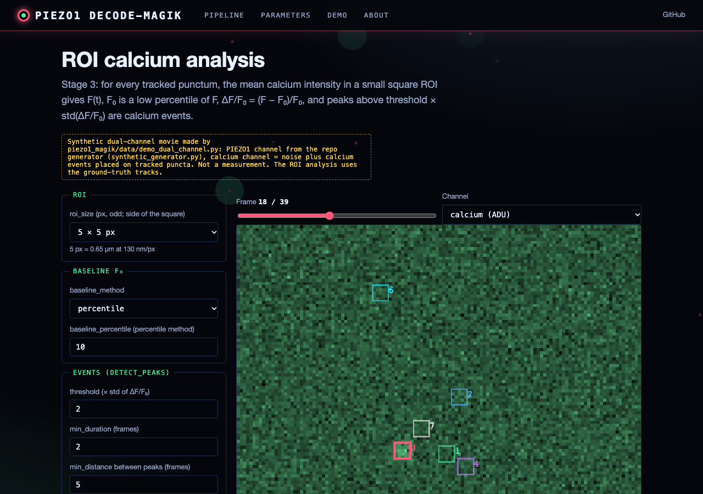
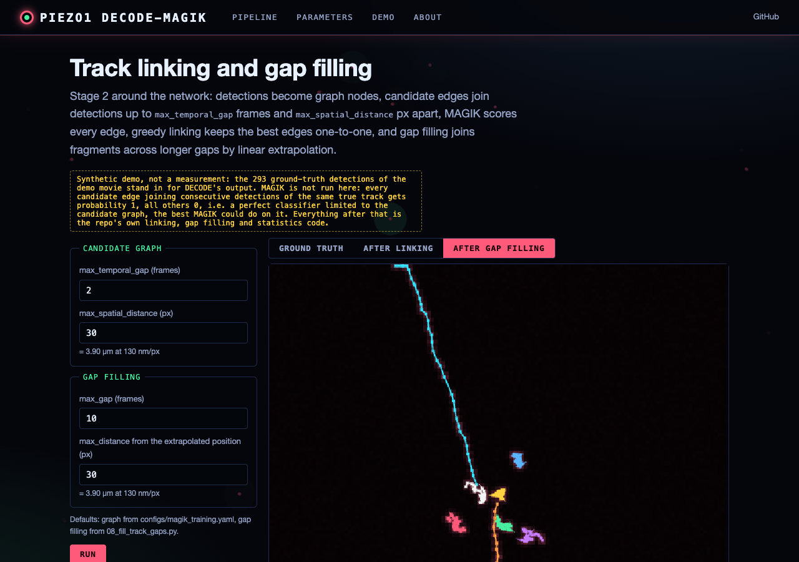
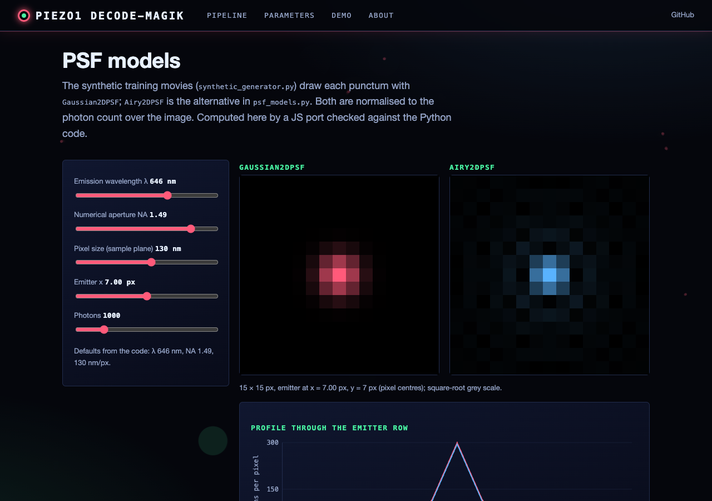

# PIEZO1 DECODE-MAGIK Tracker

**Modular pipeline combining DECODE localization, MAGIK tracking, and ROI-based calcium analysis**

1. **DECODE**: Sub-pixel puncta localization
2. **MAGIK**: Graph Neural Network tracking
3. **ROI Analysis**: Direct calcium intensity extraction

---

## Architecture Overview

```
Input: Dual-channel TIFF stack (PIEZO1 + Calcium)
         ↓
┌────────┴────────────────────────────────────────┐
│ Stage 1: DECODE Localization                   │
│ - Detects puncta per frame                     │
│ - Sub-pixel coordinates (x, y)                 │
│ - Photon counts, uncertainties                 │
└────────┬────────────────────────────────────────┘
         ↓
┌────────┴────────────────────────────────────────┐
│ Stage 2: MAGIK Tracking                        │
│ - Graph Neural Network                         │
│ - Learns to link detections across frames      │
│ - Handles blinking, splitting, merging         │
│ - Outputs: Track IDs, trajectories             │
└────────┬────────────────────────────────────────┘
         ↓
┌────────┴────────────────────────────────────────┐
│ Stage 3: ROI Calcium Analysis                  │
│ - Extract calcium intensity at each punctum    │
│ - Temporal fluorescence traces                 │
│ - Detect intensity peaks (calcium events)      │
│ - Correlate with puncta dynamics               │
└─────────────────────────────────────────────────┘
```

---

## Why This Approach?

✅ **Modular**: Each component can be trained/debugged independently  
✅ **Simpler calcium analysis**: No segmentation needed, just intensity traces  
✅ **Better tracking**: MAGIK handles complex scenarios (blinking, crowding)  
✅ **Direct biological readout**: ΔF/F₀ traces at each channel  
✅ **Proven methods**: DECODE + MAGIK are published, validated approaches

---

## Project Structure

```
piezo1_decode_magik/
├── README.md, INTERFACE.md (navigation map), ROADMAP.md, SESSION_LOG.md
├── requirements.txt, setup.py, pyproject.toml
├── docs/                              # guides (implementation, training, public datasets)
├── piezo1_magik/                      # main package
│   ├── models/
│   │   ├── decode_net.py             # DECODE localization network
│   │   └── magik_gnn.py              # MAGIK tracking GNN + build_tracking_graph
│   ├── data/
│   │   ├── synthetic_generator.py    # synthetic movies with ground-truth tracks
│   │   ├── decode_dataset.py         # PyTorch dataset for DECODE
│   │   ├── magik_dataset.py          # PyTorch dataset for MAGIK (graphs)
│   │   └── demo_dual_channel.py      # small PIEZO1 + calcium demo movie (web interface)
│   ├── tracking/                     # NumPy only
│   │   ├── linking.py                # candidate graph, greedy linking, gap filling
│   │   └── track_stats.py            # track lengths, gaps, fragmentation
│   ├── analysis/
│   │   └── calcium_roi.py            # ROI extraction, dF/F0, event detection
│   ├── utils/
│   │   └── psf_models.py             # Gaussian and Airy PSFs, camera noise
│   └── web/                          # web interface (see "Web interface" below)
├── scripts/                           # 01 data, 02 DECODE, 03 MAGIK, 04/09 pipelines,
│                                      # 06 figures, 07/08 track analysis, 11-14 downloads, 16 test
├── configs/                           # decode_training.yaml, magik_training.yaml, pipeline.yaml
└── tests/
```

---

## Key Components

### **1. DECODE Localization**

Based on Speiser et al., Nature Methods 2021:
- CNN processes 3-frame windows
- Outputs: detection probability + coordinates + uncertainties
- Trained on synthetic data with ground truth
- Achieves 20-40 nm precision

### **2. MAGIK Tracking**

Based on graph neural networks:
- Nodes: Detected puncta (one per detection)
- Edges: Potential links between frames
- GNN learns edge probabilities
- Bridges blinking: candidate edges span up to `max_temporal_gap` frames, and optional gap filling
  (`08_fill_track_gaps.py`, `09 --use_gap_filling`) joins fragments across longer gaps
- Linking is one-to-one (greedy, highest probability first; `piezo1_magik/tracking/linking.py`, used by every
  script), so tracks do not split or merge; detections with no accepted link are not part of any track

**Key features:**
- Temporal context (looks ahead/behind)
- Motion prediction
- Appearance features (intensity, size)
- Learned linking strategy (not hand-crafted rules)

### **3. ROI Calcium Analysis**

For each tracked punctum:
1. Extract 5×5 pixel ROI centered at (x, y)
2. Compute mean intensity over ROI
3. Generate fluorescence trace F(t)
4. Calculate ΔF/F₀ = (F - F₀) / F₀
5. Detect peaks → calcium events
6. Correlate with puncta dynamics

**Advantages:**
- No training needed (rule-based)
- Direct biological interpretation
- Standard calcium imaging analysis
- Easy to validate

---

## Installation

```bash
git clone https://github.com/gddickinson/piezo1_decode_magik.git
cd piezo1_decode_magik

conda create -n piezo1_magik python=3.11
conda activate piezo1_magik

pip install -r requirements.txt
pip install -e .
```

### Additional Dependencies

```bash
# For graph neural networks
pip install torch-geometric torch-scatter torch-sparse
```

---

## Quick Start

### **1. Generate Synthetic Data with Tracks**

```bash
python scripts/01_generate_synthetic_data.py \
    --output data/synthetic \
    --num_samples 5000 \
    --with_blinking  # every movie comes with ground-truth tracks
```

### **2. Train DECODE Localization**

```bash
python scripts/02_train_decode.py \
    --config configs/decode_training.yaml \
    --data data/synthetic \
    --output checkpoints/decode
```

### **3. Train MAGIK Tracking**

```bash
python scripts/03_train_magik.py \
    --config configs/magik_training.yaml \
    --data data/synthetic \
    --decode checkpoints/decode/best_model.pth \
    --output checkpoints/magik
```

### **4. Run Full Pipeline**

```bash
python scripts/04_run_pipeline.py \
    --decode checkpoints/decode/best_model.pth \
    --magik checkpoints/magik/best_model.pth \
    --input /path/to/dual_channel_movie.tif \
    --output results/
```

This will:
- Detect puncta with DECODE
- Link into tracks with MAGIK
- Extract calcium ROI traces
- Detect calcium events
- Save all results

---

## Expected Performance

These are design targets (as in the comments of `configs/*.yaml`); the repository contains no trained models
or benchmark results that reproduce them.

### **Localization (DECODE)**
- Precision: 20-40 nm
- Recall: > 90% (SNR > 5)
- Speed: 100-200 fps on GPU

### **Tracking (MAGIK)**
- Track completeness: > 80%
- Identity preservation: > 90%
- Handles 2-5 particles/μm² density

### **Calcium Analysis**
- Event detection sensitivity: > 85%
- False positive rate: < 10%
- Temporal resolution: Limited by acquisition rate

---

## Outputs

Per movie, `scripts/04_run_pipeline.py` writes to `--output`:

- `tracks.csv` - linked detections (track_id, frame, x, y, photons, sigma_x, sigma_y; positions in pixels)
- `track_statistics.csv` - per track: length, start_frame, end_frame, num_events
- `calcium_traces.csv` - per track and frame: fluorescence (ADU), dff, baseline
- `calcium_events.csv` - track_id, frame, peak_frame, amplitude (dF/F0), duration (frames)
- `summary.json` - frame, detection, track and event counts

`scripts/09_run_complete_pipeline.py` (DECODE + MAGIK, optional gap filling) writes `tracks.csv` and
`track_summary.csv` plus `tracking_overlay.png` and `track_statistics.png`.

## Biological Applications

### **What You Can Measure**

**Puncta Properties:**
- Localization precision: 20-40 nm
- Mobility classification (mobile vs immobile)
- Diffusion coefficients
- Cluster analysis

**Calcium Dynamics:**
- Event frequency per channel
- Event amplitude (ΔF/F₀)
- Event duration
- Spatial spread from punctum

**Correlations:**
- Does puncta movement trigger calcium?
- Do calcium events change puncta mobility?
- Spatial relationship between channels and events

---

## Changes that affect results (2026-11-12)

Data and results produced before these fixes are not directly comparable with new ones:

- **Synthetic PSF width.** `Gaussian2DPSF` now uses the Airy-disk FWHM, 0.5145 λ/NA (Born & Wolf, *Principles of
  Optics*, §8.5.2), instead of 0.61 λ/NA (the first-dark-ring radius). With the defaults (646 nm, NA 1.49,
  130 nm/px) σ falls from 0.864 px (112 nm) to 0.729 px (95 nm). Synthetic training data generated by `01_generate_synthetic_data.py`
  changes, so models trained on the old data were trained on puncta about 19% too wide.
- **ROIs at the image edge.** `CalciumROIAnalyzer` averaged zero-padding into ROIs that overlap the image border,
  lowering F there (and, through the low-percentile F₀, raising ΔF/F₀ elsewhere, which produced false events).
  Out-of-image pixels are now excluded from the mean, and such frames are flagged (`edge_roi` in
  `calcium_traces.csv`, `edge` in `analyze_track`).
- **Calcium event threshold.** `detect_peaks` required ΔF/F₀ > threshold × std(ΔF/F₀), measured from zero; since
  F₀ is a low percentile, ΔF/F₀ sits above zero and noise crossed it (16 of 20 detections on the web demo were
  noise). Peaks must now rise threshold × σ above the trace's median, with σ = 1.4826 × MAD (robust noise
  estimate); event edges are at half that height above the median. On the demo: 4 detections inside placed events,
  2 elsewhere. Event counts in `calcium_events.csv` change.
- **Linking in `04_run_pipeline.py`.** It joined all edges above `--link_threshold` into connected components (so
  crossing or nearby particles merged into one track, and every unlinked detection became a one-point track). It now
  uses the same greedy one-to-one linking as 03c/07/08/09.

---

## Web interface

A web interface documents the pipeline and runs its lightweight stages on a synthetic demo movie.
Static site (GitHub Pages): https://gddickinson.github.io/piezo1_decode_magik/

| Page | What it shows |
|---|---|
| Pipeline | the three stages, inputs/outputs, networks, linking rules, with source files |
| Parameters | every value in `configs/*.yaml` and every script option, with units (px, frames, nm, photons) and px in um at 130 nm/px |
| ROI calcium analysis | F(t), dF/F0 and events at every tracked punctum of the demo; ROI size, baseline and thresholds adjustable |
| Track linking and gap filling | candidate graph, greedy linking and gap filling on the demo detections, scored against ground truth |
| PSF models | the Gaussian and Airy PSFs of the synthetic-data generator |

The demo movie is synthetic (`piezo1_magik/data/demo_dual_channel.py`: the repo's generator plus a calcium channel
with events placed on tracked puncta) and is labelled as such. DECODE and MAGIK need PyTorch and trained checkpoints,
so they run only locally through the scripts; on the static site the ROI analysis, linking/gap filling and PSFs run in
the browser as JS ports (`piezo1_magik/web/static/*_engine.js`) that node tests check against the Python output.

### Run the web app

```bash
pip install -r requirements-web.txt
python run_web.py          # http://127.0.0.1:8209 (local only); analyses run in Python
python -m pytest -q tests  # includes the web and JS-vs-Python tests (node 22 for the latter)
python scripts/build_static.py --out site   # the static site
```






---

## Citation

If you use this pipeline:

```
DECODE: Speiser et al., Nature Methods 2021
MAGIK: Jiang et al., (DeepTrack 2.0)
PIEZO1-HaloTag: Bertaccini et al., Nature Commun 2025
```

---

## License

MIT License - See LICENSE file

---

## Contact

George Dickinson  
UC Irvine
george.dickinson@gmail.com

---

See `docs/IMPLEMENTATION_GUIDE.md` for detailed instructions!


---
*Built with AI assistance from [Claude (Anthropic)](https://claude.com/).*
